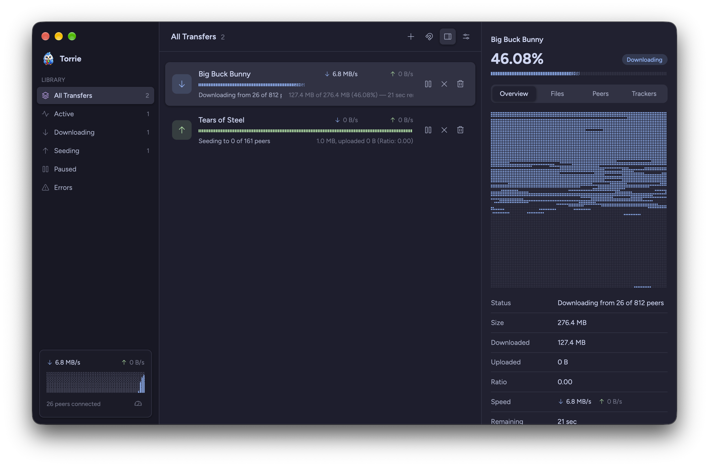
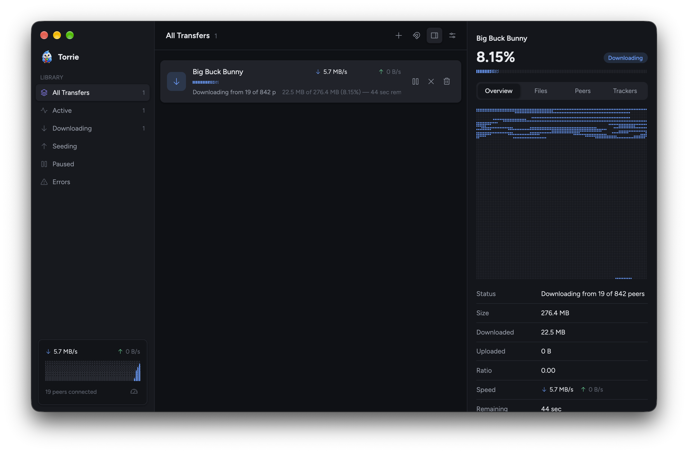
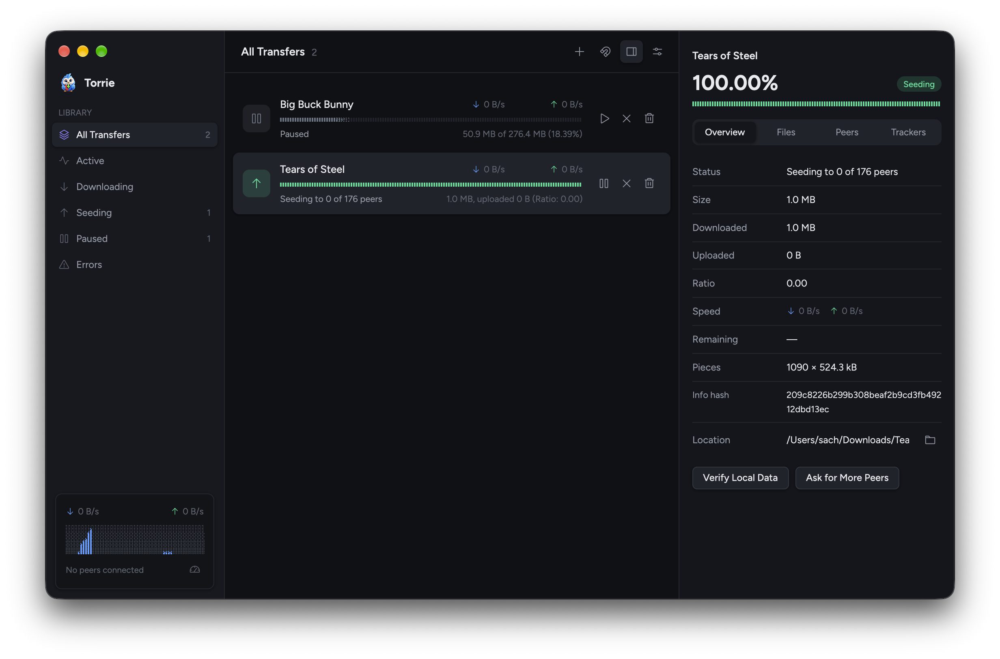
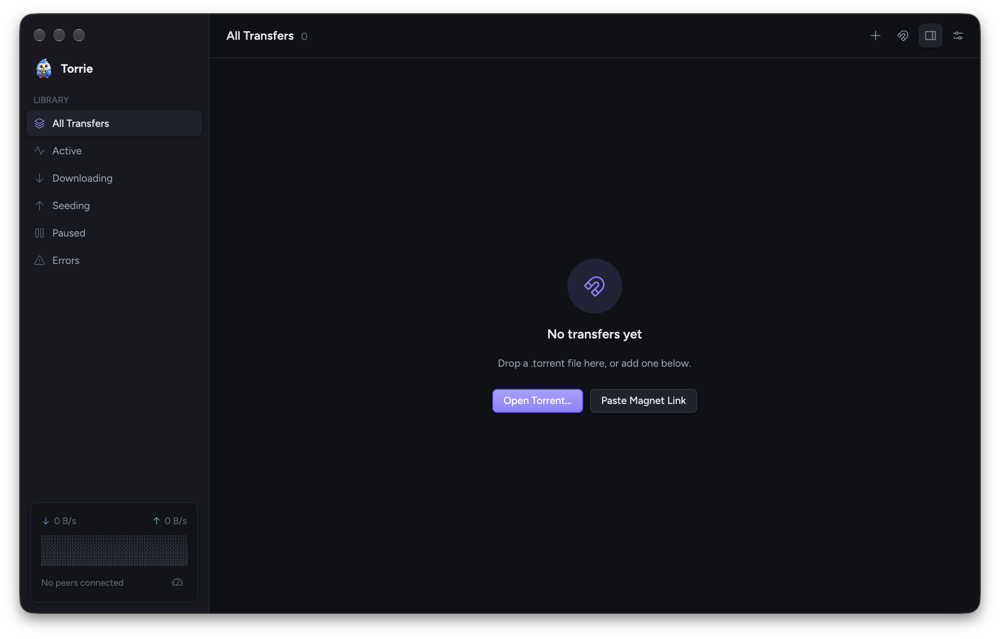
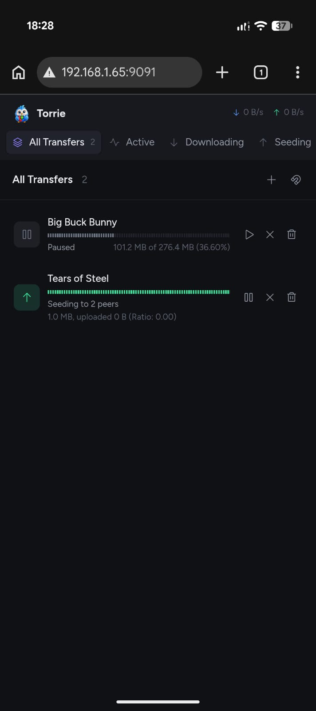

<p align="center">
  
</p>

<h1 align="center">Torrie</h1>

<p align="center">
  A fast, simple BitTorrent client for macOS.<br>
  Native UI, plugins, and a remote control API.
</p>

<p align="center">
  <a href="https://dl.kronz.xyz/torrie/Torrie.dmg"><b>Download for macOS</b></a> ·
  macOS 12+ · <a href="LICENSE">MIT</a>
</p>

<p align="center">
  
</p>

---

## Features

- **Add anything**: drag in `.torrent` files, click `magnet:` links, or paste one with ⌘U
- **Choose files** before and during a download, with per-file progress
- **Inspector** (⌘I): overview, files, peers with country flags, trackers
- **Speed limits** with an alternative set you can schedule by time and weekday
- **Watch while downloading**: play video and audio in IINA, VLC or your default player
- **Menu bar item** with live speeds, and opening at login
- **Plugins**: add menu commands, Inspector tabs and settings, or run scripts when a download finishes ([guide](site/docs/plugins.md))
- **Web remote**: manage downloads from any browser on your phone or another computer ([how](#remote-control))
- **Remote control**: an API for your own apps and scripts ([guide](site/docs/remote-control.md))
- **Updates itself**, and only installs notarized builds signed by the same developer
- **16 themes**: Catppuccin, Dracula, Gruvbox, Nord, Rosé Pine, Solarized, Tokyo Night and more, with separate light and dark picks that follow macOS
- DHT, UPnP, stop seeding at a ratio, fast resume

## Screenshots

| | | |
|---|---|---|
|  |  |  |

## Remote control



Control Torrie from your phone, another computer, or your own apps and scripts.

1. Settings → Network → turn on **Remote control**, and **Allow other devices** for anything that isn't this Mac.
2. Restart Torrie.
3. Open `http://<your Mac's IP>:9091` in any browser. Sign in with any username and the password shown in Settings. The browser remembers you.

Away from home, forward port 9091 or reach it over a VPN. It is plain HTTP, so a VPN keeps the password private. Connecting other apps and the JSON-RPC API are covered in the [remote control guide](site/docs/remote-control.md).

## Build

Needs Rust stable on macOS 12 or later. You don't need Xcode's Metal toolchain because shaders compile at runtime.

```sh
cargo run                         # dev build
cargo test
apps/torrie/scripts/bundle.sh     # target/Torrie.app (ad-hoc signed)
apps/torrie/scripts/build-dmg.sh  # target/Torrie.dmg (needs uv)
apps/torrie/scripts/release.sh    # signed, notarized release + update feed (setup notes in the script)
```

To make Torrie open `.torrent` files and `magnet:` links, move `Torrie.app` to `/Applications` and launch it once.

Settings save to `~/Library/Application Support/Torrie/settings.json`.

## Built with

| | |
|---|---|
| [librqbit](https://github.com/ikatson/rqbit) | BitTorrent engine: DHT, peers, file streaming, fast resume |
| [GPUI](https://gpui.rs) | Zed's GPU-accelerated UI framework |
| [Tokio](https://tokio.rs) + [axum](https://github.com/tokio-rs/axum) | Async runtime and the remote control server |
| [tray-icon](https://github.com/tauri-apps/tray-icon) + [objc2](https://github.com/madsmtm/objc2) | Menu bar item and AppKit integration |
| [resvg](https://github.com/linebender/resvg) | SVG icon rendering |
| [maxminddb](https://github.com/oschwald/maxminddb-rust) | Peer country lookup |

## Contributing

Bug reports, fixes and plugins are welcome. See [CONTRIBUTING.md](CONTRIBUTING.md).

## License

[MIT](LICENSE) © 2026 [Kronz](https://kronz.xyz)

Bundled: [Figtree](https://github.com/erikdkennedy/figtree) font (SIL OFL 1.1), [Phosphor](https://phosphoricons.com) icons (MIT), and [IP Geolocation by DB-IP](https://db-ip.com) (CC BY 4.0).
